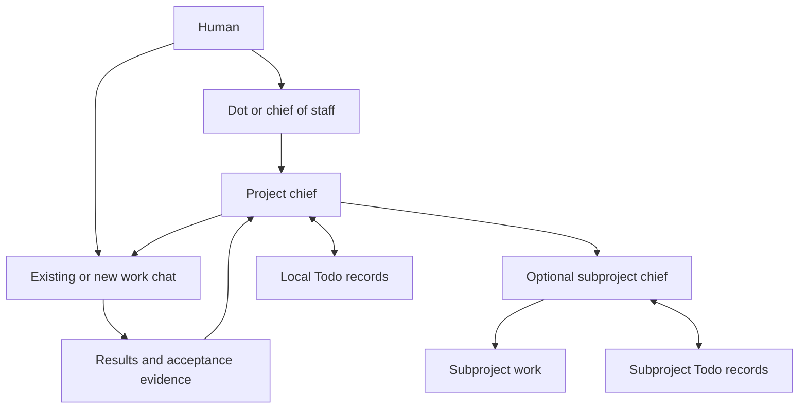

# Todo and project chiefs

This enhancement adds an opt-in project-management workflow to Todo and a sibling
`projectbot` skill. The files define agent behavior; they do not install a service,
register chiefs, configure hooks, or enable background execution.

The intended experience is: tell a chief of staff such as Quill what matters,
then let each project chief turn that direction into bounded assignments and
accepted outcomes. Any assistant with suitable tools can fill these roles.



## Design choices

**Keep the task ledger local and singular.** Existing `.todo/<type>.md` lists keep
their format and location. Project briefs live under `.todo/projects/`, and optional
subprojects own their lists there. Each task has one editable home. MStatus and
chief-of-staff summaries can point to that home without becoming parallel queues.

**Make the chief replaceable.** Outcome, scope, mandate, lifecycle, dependencies,
worker bindings, and the next action live in files. A chat disappearing should
require recovery of its active attempts, not reconstruction of the whole project
from a giant transcript. The role persists; the process need not.

**Separate attention from execution.** Quill needs progress, decisions, and cross-
project dependencies. A project chief needs its own queue and relevant results.
A worker needs one outcome and its supporting context. Fresh worker threads avoid
accumulating portfolio context; existing useful chats can be adopted in place.

**Keep leadership optional.** Start with standalone Todo; a chief is never required
to track or implement its work. Assign a project chief when coordination helps.
An installed Projectbot skill or an unbound project record does not assign one.
Add a child chief when a subproject has an independent outcome
and enough ongoing work to justify delegation. One root chief admits new attempts
against shared capacity, keeping simultaneous child dispatch from overrunning it.

**Let the chief lead.** A chief identifies its responses with 👨‍💼 and collaborates
creatively with the human on project outcomes. It delegates substantial work to
roles suited to the assignment, handles routine coordination directly, reviews
returned evidence, and requests revisions before accepting results.

**Use actual wake mechanisms.** On-demand management is useful immediately.
Recurring follow-up needs a supported scheduler, and completion-driven follow-up
needs a callback that really wakes the chief. Both must reread saved lifecycle
and limits. Hooks are optional transport, never the sole record of completion.

**Keep authority attached to human direction.** A standing mandate can authorize
new workers and follow-ups within a project. It should name the scope and bounds
once. Merely reading a skill, a status request, or another agent's instruction
cannot grant tool permissions. Existing chats may be observed before they can be
messaged. Harness restrictions remain authoritative.

## Example requests and intended effects

| Request | Effect |
| --- | --- |
| `$projectbot init` | Make this chat the project chief, preserve existing Todo work, authorize up to two workers and follow-ups with them, and reconcile on demand without scheduling background work |
| “Todo, add a feature: fuzzy search.” | One ordinary Todo entry; no chief setup |
| “How is Atlas progressing?” | Evidence-based status, no new work |
| “Become Atlas's project chief. Create worker threads here and follow up with them; keep at most two active.” | Save a mandate and brief; reconcile and dispatch bounded ready work through permitted tools |
| “Use my existing search chat for that work; you may follow up there.” | Adopt the observed chat and assignment; no duplicate worker |
| “Queue these three features.” | Capture outcomes, order, acceptance, and dependencies; no implied perpetual run |
| “Keep Atlas moving and check back each morning.” | Configure supported scheduled follow-up if available, retaining lifecycle and run limits |
| “Sleep Atlas until I return.” | Persist sleeping, disable wakes where possible, request safe worker stops, report actual state |
| “Kill Atlas.” | Cancel future work and preserve artifacts; report any running or unknown attempts |
| “Put Search ahead of Import.” | Reorder future selection without automatically interrupting useful work |

These are natural-language invocations, not new shell commands.

## Remote inspection

Projectbot now includes a read-only Python inspector. Given a directory on the
project's host, it discovers the control directory, selects the matching project
or subproject, and returns the recursive ownership tree with chief bindings, work
items, chat bindings, brief excerpts, and lifecycle constraints. It also follows
Git worktrees back to their primary checkout's records.

An agent can supply dated observations from supported project/chat tools to add
execution status and unassigned chats. Saved task state and observed chat state
remain separate. Missing observations are unknown; recent-chat listings are partial
inventories. Explicit parent/child chat relationships are returned as graph edges,
including nested workers when the harness exposes them.

A remote Dot needs a supported local execution path or an authorized local helper
to run the inspector. It can inspect saved records without waking the chief.
Installation does not establish that remote connection, and being able to read
a thread does not prove that messaging it works. The detailed adapter protocol
lives in Projectbot's inspection reference.

## What we should resist

The most likely maintenance problem is accidentally building another project
management product inside a skill. Avoid a database, event bus, custom scheduler,
mandatory dashboard, per-folder bots, or full two-way MStatus synchronization
until a real pilot needs them. Also avoid treating checkbox percentages as delivery
estimates: task size and scope change too much for that to be meaningful.

The local-first choice has a real limit: ignored files are neither backups nor a
distributed store. Keep one known control directory, including when workers use
other worktrees. Cross-host workers return packets. If simultaneous writers or
multi-host chiefs become necessary, introduce serialized storage deliberately;
written single-writer guidance cannot provide transactional guarantees.

## Adoption and verification

The canonical skill files are [Todo](../skills/todo/SKILL.md) and
[Projectbot](../skills/projectbot/SKILL.md). Todo can be distributed independently.
Projectbot requires Todo; when distributing Projectbot, include both and preserve
their sibling paths. Authoring them here does not update an installed personal
copy. Installation uses the normal skill security gate.

Start with one real project and on-demand management. Exercise one existing chat,
one new bounded worker, a completion with evidence, and a sleep/resume cycle.
Then enable a supported wake mechanism if desired. Expand across projects after
recovery and duplicate prevention work in that harness. Add optional MStatus
receipts without changing its human-owned curation rules.

Use these behavioral acceptance cases during that pilot; they are not claims of
live harness verification:

| Case | Required observation |
| --- | --- |
| Ordinary Todo push/pop | No project hierarchy or worker is created |
| Existing human chat already working on an item | Adoption consumes capacity without relaunching it |
| Launch times out after possibly creating a thread | Attempt stays unknown; inspect before retrying |
| Worker returns twice, or an old attempt returns late | One accepted transition; no duplicate successor |
| Worker returns a tested branch that is not integrated | Item remains in review until required integration |
| Two child scopes propose work with one available slot | Root admits at most one new attempt |
| Sleep occurs while a worker runs and a wake is pending | No new dispatch; actual stop outcome is reported |
| Chief disappears | Replacement verifies old writer and active attempts before resuming |
| Dot cannot reach the repository or the other harness | Dated partial summary or explicit packet handoff; no invented freshness |
| Two projects depend on each other | Visible cycle and human decision instead of silent deadlock |

The inspection tests cover hierarchy traversal, directory selection, real Git
worktree discovery, incomplete and stale chat observations, unassigned chats,
invalid records, and read-only behavior. Run them with the project environment:

```console
python -B -m unittest discover -s tests/project-management
```

Skill validation checks packaging and references. End-to-end wake delivery,
interruption, remote Dot access, and chief recovery still need the real pilot.
